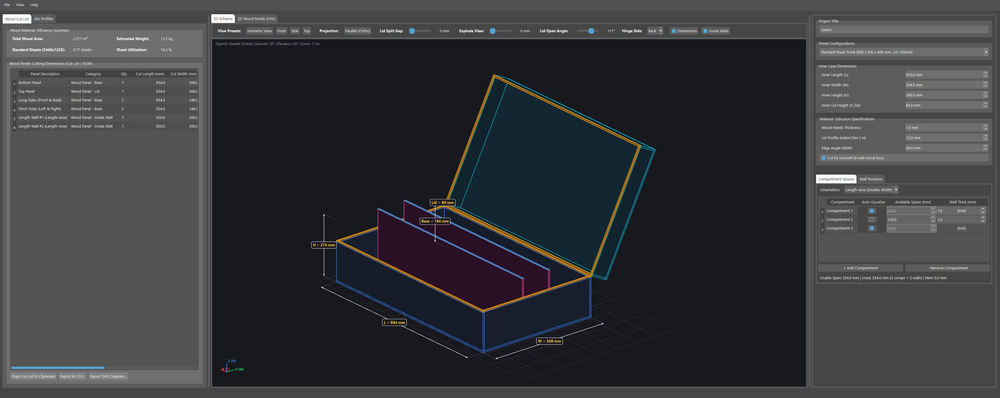

# Flightcase Calculator

A desktop CAD/CAM estimation and design tool built with Python, PySide6, and OpenGL to streamline the design, calculation, and fabrication of custom flightcases and road trunks.



---

## Features

- **Precise Material Calculations**: Automatically computes exact cut dimensions, surface areas, and quantities for wood panels (sides, lid, base, top) and aluminum profiles (corner extrusions, lid mating profiles).
- **Interactive 3D OpenGL Visualizer**:
  - Full 3D orbit, pan, and zoom navigation.
  - Exploded view slider with automatic panel dimension callouts.
  - Interactive lid opening simulation with variable hinge sides (Back, Front, Left, Right) and 0°–180° rotation.
  - Dynamic inner partition wall visualization and selection highlighting.
  - Support for both standard split-lid construction and self-cut lid (6-wall uncut box) workflows with cut markings.
- **2D Wood Panels Technical Drawings (SVG)**:
  - Generates printer-friendly, high-contrast vector cut sheets.
  - Interactive 2D viewport with smooth pan and zoom.
  - One-click SVG export formatted for physical print or laser/CNC cut prep.
- **Custom Internal Partitions**: Configure inside dividing walls along X and Y axes with real-time recalculation.
- **Project Management**: Save and load custom `.fcproj` project files, presets, and customized project titles.
- **Dark Desktop UI**: Integrated theme optimized for workshop environments.

---

## Requirements

- Python >= 3.10 (tested on Python 3.14)
- Supported operating systems: Windows, macOS, Linux

### Core Dependencies

- `PySide6`: Modern Qt-based desktop UI
- `PyOpenGL`: Hardware-accelerated 3D wireframe and solid surface rendering
- `numpy`: Fast 3D vector and matrix geometric transformations
- `pytest`: Automated test suite

---

## Getting Started

### 1. Installation

Clone or download the repository, then install dependencies:

```bash
# Using uv (recommended)
uv sync

# Or using standard pip
python -m venv .venv
# Windows:
.venv\Scripts\activate
# Linux / macOS:
source .venv/bin/activate

pip install -e .
```

### 2. Running the Application

- **Windows Shortcut**: Double-click `run.cmd` or execute:
  ```cmd
  run.cmd
  ```
- **Direct CLI Execution**:
  ```bash
  python main.py
  # or with uv
  uv run python main.py
  ```

### 3. Running Automated Tests

Run the complete test suite:

```bash
pytest
```

---

## AI Attribution & Development Note

This software was developed with the assistance of Artificial Intelligence (AI) for architecture design, geometric calculations, 3D/2D rendering workflows, and comprehensive automated test suites.
